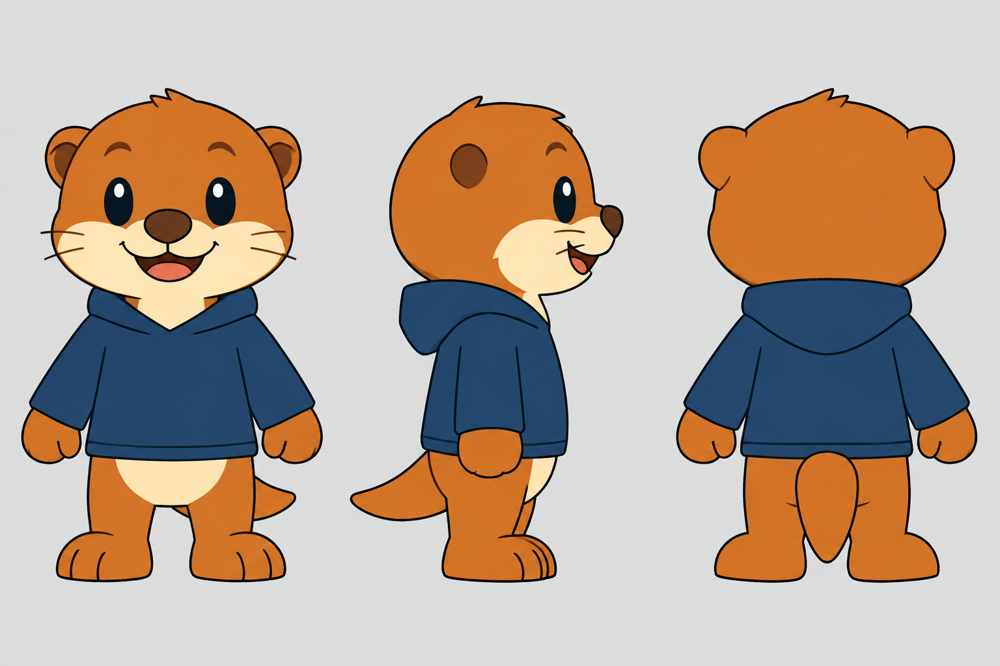
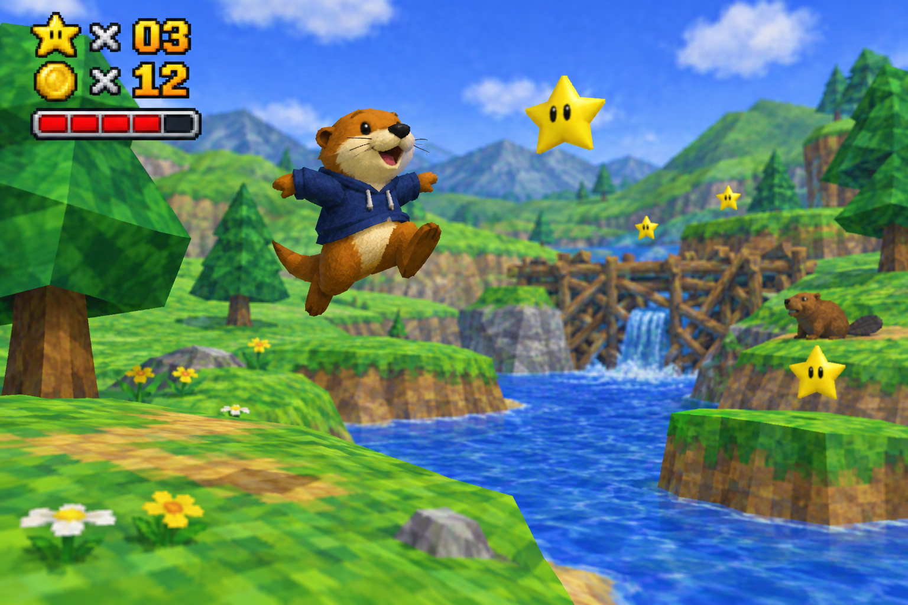

# Otto the Otter — character design

Otto is the playable hero of **Otto 64**, a Mario 64-style ROM hack for the Nintendo 64
built on [HackerSM64](https://github.com/HackerN64/HackerSM64). His design is based on the
Cognition otter mascot.

## Look

| Element | Spec |
| --- | --- |
| Fur | Amber-orange, flat vertex color |
| Muzzle / belly | Cream, flat vertex color |
| Outfit | Navy blue hoodie — Otto's signature, the way overalls are Mario's |
| Nose | Small, dark brown, rounded |
| Proportions | SM64 mascot scale: big head, stubby limbs, chunky tail — reads at 320×240 |
| Budget | ~400–700 tris; ~10–14 flat colors; face as swappable 32×32 textures (open / blink / open mouth) |

## Signature verbs

Mario 64's physics are kept verbatim; the moves are reskinned to feel otter:

- **Dive → belly-slide** — otters slide on mud banks
- **Swim → otter edge** — faster, nimbler in water than Mario
- **Wall-kick → tail-assisted**
- **Ground-pound → tail slam**
- **Idle → tail sway, whisker twitch**

## Rig note

The SM64 player skeleton has no tail. Add one geo node for the tail; ship a static
version first, animate it in the custom-anim pass.

## Enemies → otter predators

Vanilla level layouts are kept; every enemy is reskinned to a natural otter predator or
river hazard. Behavior is preserved — the reskin is model, texture, voice, and name only.

| SM64 enemy | Otto 64 version | Why it fits |
| --- | --- | --- |
| Goomba | Prowling fox kit | Ground stalker that lunges |
| Bob-omb | Wasp | Small, buzzing, detonates when it catches you |
| Big Bob-omb | Grizz the bear | The mountain's boss brawler; throws Otto |
| King Bob-omb rematches | Hornet Queen | Royal version of the wasp theme |
| Koopa Troopa | Snapping turtle | Classic river hazard; shell mechanic identical |
| Piranha Plant | Alligator gar | Predator fish snapping out of the water hole |
| Chain Chomp | Chained coyote | Lunging tethered predator |
| Boo | Shadow owl | Silent night stalker that appears behind you |
| Whomp | Stomping moose | Huge animal that flattens you |
| Bullet Bill | Diving osprey | Launched aerial predator |
| Lakitu | Great blue heron | Fishing rival hovering overhead |
| Spiny | Porcupine | Can't be jumped on — quills |
| Swooper | Bat (kept) | Already nature |
| Mr. Blizzard | Snow wolf | Icy-biome predator |
| Bowser | King Croc | Apex river predator and final boss |

## Collectibles and ambience

- **Power Stars → Golden Trout** — otters chase fish; collecting them powers the lodge
- **Coins → clams** — otters hoard shells
- **Castle hub → Otto's lodge** (a big beaver-style dam home)
- **Bob-omb Battlefield → Willowbank** — riverbank meadow
- **Jolly Roger Bay → Otter Cove**
- **Big Boo's Haunt → Owl Hollow** — haunted old tree
- **Cool Cool Mountain → Frostjaw Peak**
- **Wet-Dry World → The Marshlands**
- **Hazy Maze Cave → Root Tunnels**
- **Lethal Lava Land → Wildfire Ridge** — forest fire, natural hazard
- **Shifting Sand Land → Dryriver Flats** — a riverbed King Croc drained dry
- Story hook: King Croc's great dam choked the river and scattered the Golden Trout;
  Otto collects them to restore the water.

## NPCs

Peach's castle role becomes the otter colony in the lodge; Toads become river animals
(beavers, frogs, ducks) that hand out hints.
